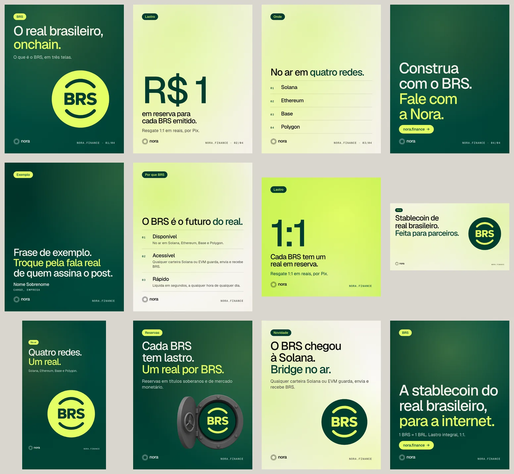

# Manual de marca da Nora

Vale para tudo que leva a marca da Nora ou do BRS: post, anúncio, apresentação,
documento, página. As referências vivas são o site [nora.finance](https://www.nora.finance)
e as peças que a Nora publica no X e no LinkedIn; este manual registra o que
elas usam e como repetir.

Há dois jeitos de fazer uma peça, e os dois saem iguais:

- **Pelo gerador:** descreva o post num JSON e o gerador deste repositório
  monta a arte. A seção [Gerador](#gerador) explica.
- **Em Figma, Canva ou outra ferramenta:** use os arquivos de
  [Assets](#assets) (fundos de arcos, logo, marca do BRS, fontes e cores) e
  siga o [Sistema visual](#sistema-visual).

## A marca em uma frase

A Nora opera a rede por trás do BRS, a stablecoin do real brasileiro, feita
para as plataformas que levam o real para a blockchain.

- **Nora** é a empresa e a rede. **BRS** é a stablecoin. São duas marcas: a
  Nora assina, o BRS é o produto.
- Escreva `BRS` em maiúsculas, `Nora` com inicial maiúscula, `onchain` junto,
  `Pix` assim.

Fatos que o site afirma e que uma peça pode repetir sem outra fonte:

- 1 BRS = 1 BRL, com lastro integral, 1:1.
- As reservas ficam em títulos soberanos e de mercado monetário.
- O resgate é 1:1 em reais, por Pix.
- O BRS está no ar em Solana, Ethereum, Base e Polygon, com bridge para a Solana.
- Qualquer carteira Solana ou EVM guarda, envia e recebe BRS.
- A liquidação leva segundos, a qualquer hora de qualquer dia.

## Sistema visual

Toda peça da Nora se reconhece por seis elementos. O resto do manual detalha
cada um.

1. **Fundo:** verde-noite `#001D17` nas peças de anúncio; papel `#F4F1EA`
   quando a peça é clara.
2. **Arcos:** um anel grande em degradê de lima, com brilho, e um segundo anel
   no canto de baixo, à esquerda.
3. **Logo no topo, à esquerda.**
4. **Título pesado, em até duas linhas,** com o fecho em lima.
5. **Rótulo em maiúsculas espaçadas,** em lima, acima do título ("ANGEL
   INVESTOR", "PARCERIA").
6. **Imagem à direita** nos formatos deitados, **embaixo** nos em pé: retrato,
   marca do BRS, ilustração ou foto, com brilho lima em volta.



As peças se dividem em duas famílias:

| Família | Peças | Como compõe |
|---|---|---|
| **Anúncio** | parceiro, lançamento, evento, pessoa | os seis elementos acima, com os dois arcos acesos |
| **Explicação** | dado, lista, citação, carrossel | texto denso: logo e assinatura no rodapé, fundo de malha suave; com arcos, o de baixo fica apagado, porque passa por trás do texto |

## Voz

Direta, calma e precisa. Quem lê é gente de produto, tesouraria e engenharia
de fintechs e exchanges.

- Frase curta, verbo ativo, uma ideia por peça.
- Título em até duas frases. O destaque de cor marca o fecho: a segunda frase
  ("O BRS chegou à Solana. **Bridge no ar.**") ou o trecho final
  ("O real brasileiro, **onchain.**").
- Número e fato fora da lista acima só com fonte pública (site, documentação,
  dado onchain) ou vindos de quem pediu a peça. Sem fonte, a peça sai sem o número.
- Descreva o que o BRS é e faz. Rendimento, retorno, yield, ganho, taxa e
  percentual ficam fora da peça. Se o assunto pedir (a economia da rede para
  parceiros, por exemplo), pergunte a quem pediu como dizer.
- Na arte: sem emoji, sem ponto de exclamação, sem urgência ("últimas vagas",
  "não perca"), sem superlativo ("o maior", "revolucionário").
- Português do Brasil por padrão; inglês quando o público da peça é de fora,
  como no X e no LinkedIn.

O gerador barra emoji e ponto de exclamação na arte. O resto da voz depende de
quem escreve: ele não sabe se uma frase promete demais.

## Cores

Fonte única: [`colors/tokens.json`](colors/tokens.json) (também em
[CSS](colors/palette.css), [SCSS](colors/palette.scss) e
[Tailwind](colors/tailwind.colors.js)).

| Cor | Hex | Papel |
|---|---|---|
| Verde-noite | `#001D17` | fundo das peças com arcos |
| Papel | `#F4F1EA` | fundo claro |
| Verde | `#003C2F` | fundo escuro das peças de malha, destaque de título no claro, disco do BRS |
| Lima | `#C6F24E` | arcos, botão e chamada, fundo de destaque |
| Lima do BRS | `#E3FF63` | marca do BRS, ponta acesa dos arcos, destaque e rótulo sobre o escuro |
| Tinta | `#0A0A0A` | texto sobre papel e sobre lima |
| Pedra | `#4A4740` | texto de apoio sobre papel |
| Sálvia | `#C9D7D0` | texto de apoio sobre o escuro |

- Uma peça usa um fundo só. Com arcos: verde-noite ou papel. Com malha: papel,
  verde ou lima.
- Par de texto por fundo: tinta sobre papel e lima; papel sobre o escuro. O
  destaque é verde no claro e lima do BRS no escuro.
- As duas limas não se misturam na mesma função: `#C6F24E` é da Nora (botão,
  fundo), `#E3FF63` é do BRS (marca e destaque sobre o escuro).
- Arcos e malha usam só cores da paleta (as da tabela e os tons de apoio de
  `tokens.json`). Nunca uma cor de fora.
- Preto `#000000` e os cinzas continuam na paleta para produto e documento
  (terminal de código, interface). Peça de comunicação usa os fundos acima.
- Apresentações de 2026 usam vizinhos quase idênticos (`#003C30`, `#E2FB56`,
  `#F7F6F1`). Seguem válidas; material novo usa os valores desta tabela.

## Tipografia

**Geist** para tudo; **Geist Mono** para assinatura e numeração. As duas são
abertas (SIL Open Font License) e estão em [`fonts/`](fonts/), na versão 1.7.2
do projeto [vercel/geist-font](https://github.com/vercel/geist-font).

- Título de anúncio: Geist SemiBold (600), entrelinha 1,04, letras apertadas
  (-0,035em).
- Título de explicação: Geist Medium (500), entrelinha 1,02, letras apertadas
  (-0,045em).
- Texto: Geist Regular (400), entrelinha 1,32.
- Rótulo: Geist Medium, maiúsculas, espaçamento de 0,3em, em lima do BRS.
- Assinatura e numeração: Geist Mono Medium, maiúsculas, espaçamento de 0,12em.
- O logo já vem em curvas: nunca redigite "nora" numa fonte.
- Apresentações de 2026 em Instrument Sans seguem válidas; material novo usa Geist.

## Logo da Nora

Arquivos em [`logo/`](logo/). O símbolo tem 17 raios.

- Sobre papel e lima: variante `on-light` (preta). Sobre o escuro: `on-dark` (papel).
- Área livre de 12,5% da maior dimensão em volta. Use `padded` quando a peça
  não garante essa folga e `tight` quando o layout já garante.
- Use o arquivo como está: sem esticar, girar, recolorir, contornar, aplicar
  brilho ou redesenhar os raios.
- O logo que assina uma peça é sempre o arquivo oficial; nenhuma IA o desenha.
  As versões 3D do símbolo em `social/ilustracoes/` são ilustração: entram
  como arte e não substituem o logo.
- **Posição:** no topo, à esquerda, nas peças de anúncio; no rodapé, à
  esquerda, nas de explicação. O gerador põe sozinho.
- Logo de parceiro entra acima do título, nunca ao lado do logo da Nora no
  topo, e na versão clara do parceiro quando o fundo é escuro.

## Marca do BRS

Disco chapado verde `#003C2F` com a sigla BRS e duas curvas em lima `#E3FF63`.
Arquivos oficiais em [Nora-Finance/brs-assets](https://github.com/Nora-Finance/brs-assets);
as duas variantes usadas em post estão em [`social/brs/`](social/brs/).

- Sobre papel e lima: disco verde. Sobre verde com malha: disco lima. Sobre o
  verde-noite com arcos: disco verde, com brilho lima em volta. O gerador
  escolhe sozinho em `"arte": "brs"`.
- O disco é chapado: sem aro, anel, friso, filete ou borda metálica, e sem
  brilho de moeda. O brilho das peças com arcos fica em volta do disco, nunca
  nele.
- Em ilustração 3D o disco é sempre o verde, com espessura e a lateral no
  mesmo verde fosco.

## Arcos

Os arcos são o grafismo da marca: um anel grande em degradê de lima, com
brilho, e um segundo anel no canto de baixo, à esquerda. O degradê vai da lima
do BRS `#E3FF63`, na ponta acesa, à lima `#C6F24E` e some no fundo.

- **Sobre verde-noite:** os dois anéis acesos. É o padrão das peças de anúncio.
- **Sobre papel:** os dois anéis em lima clara.
- **Deitado** (`paisagem`, `horizontal`): o anel grande entra pelo alto, à
  direita, e passa por trás da imagem.
- **Em pé e quadrado** (`feed`, `story`, `quadrado`): o anel grande fica
  embaixo, em volta da imagem, e nunca sobe por trás do texto.
- O desenho é fixo, igual em toda peça. Nada de arco de outra cor, de outro
  lado ou cruzando o texto.

Fundos prontos, um por tema e formato, em [`social/fundos/`](social/fundos/)
(`arcos-verde-feed.jpg`, `arcos-papel-horizontal.jpg` e os demais): servem a
quem monta a peça fora do gerador. No gerador, `"fundo": "arcos"` liga os arcos.

## Peças

Cada tipo de peça tem uma receita no gerador. Os exemplos prontos, com o JSON
de cada um, estão em [`social/exemplos/`](social/exemplos/).

### Anúncio

Parceiro novo, lançamento, evento, novidade. Layout `titulo` com
`"fundo": "arcos"`: logo no topo, rótulo, título com o fecho em lima, uma
linha de apoio e a imagem.

```json
{
  "formato": "horizontal",
  "layout": "titulo",
  "tema": "verde",
  "fundo": "arcos",
  "selo": "Parceria",
  "titulo": "Agora com\n*BRS.*",
  "texto": "Mais uma plataforma na rede do BRS.",
  "arte": "brs"
}
```

- **Parceiro:** `"arte": "brs"` e, se houver, o logo do parceiro em
  `"parceiro": "logo.svg"` (PNG, WebP ou SVG, versão clara no fundo escuro).
  Ele entra acima do título.
- **Evento:** lugar e data no título ("Londres.\n*12 de novembro.*"), sem arte
  ou com uma foto do lugar em `"arte": "imagem"`.
- **Lançamento no claro:** `"tema": "papel"`, com uma ilustração.
- **Formato:** `horizontal` ou `paisagem` no X e no LinkedIn, `feed` no
  Instagram, `story` nos stories.
- A peça não tem rodapé; `rodape` é recusado. Em carrossel, a numeração
  aparece numa pílula no alto, à direita.

### Pessoa

Layout `pessoa`, sempre no verde-noite com arcos. Tem duas peças.

**Spotlight do time.** Apresenta alguém do time: quem é, o que construiu antes
e o que faz aqui. Uma pessoa por post. Referências no ar:
[João Bilesimo](https://x.com/norafinancexyz/status/2120198582796009505) e
[André Rocco](https://x.com/norafinancexyz/status/2123034716182094108).

```json
{
  "formato": "horizontal",
  "layout": "pessoa",
  "tema": "verde",
  "nome": "Nome Sobrenome",
  "cargo": "Founding Engineer",
  "foto": "foto-recortada.png"
}
```

Sem `selo`, a peça abre com a linha "Nora team Spotlight". O cargo sai numa
pílula. O texto do post, em inglês, tem três partes:

```text
Introducing @perfil          (no LinkedIn: Introducing Nome Sobrenome)

At [onde trabalhou], [Nome] [o que construiu, com um fato que se confere].

Now, as [cargo] at Nora, [he/she] [o que faz na Nora].
```

Uma linha final pode ligar a pessoa ao produto ("$BRS is built to scale.").

**Entrada de pessoa.** Anuncia quem chega: investidor, conselheiro, sócio.

```json
{
  "formato": "quadrado",
  "layout": "pessoa",
  "tema": "verde",
  "selo": "Angel Investor",
  "nome": "Nome Sobrenome\n*joins Nora.*",
  "texto": "Co-founder da Empresa\nEx-diretor da Fundação",
  "fecho": "More than *capital.*",
  "foto": "foto.jpg"
}
```

O `selo` vira o rótulo, o `texto` descreve a pessoa em até três linhas e o
`fecho` é a frase final, depois de um traço em lima.

Vale para as duas:

- **Foto:** retrato real da pessoa, cedido por ela, do peito para cima.
  Recortada (PNG ou WebP com fundo transparente), ela sangra pela base da
  peça, com brilho nos ombros; o gerador apara a sobra em volta, e o tronco
  precisa ir até a base da foto. Sem recorte (JPG, por exemplo), entra num
  círculo com aro em lima. Para recortar:
  `uvx --from "rembg[cpu,cli]" rembg i -m isnet-general-use foto.jpg foto.png`.
  Confira o contorno do cabelo e se não sobrou resíduo solto. Remover o fundo
  pode; nenhuma IA gera nem retoca rosto.
- **Nome:** cabe numa linha e diminui sozinho; `\n` abre a segunda. Com nome
  ou cargo longo, confira no PNG se o texto não encosta no rosto.
- **Formato:** `horizontal` no X e no LinkedIn (é o das edições no ar), `feed`
  no Instagram, `story` nos stories. No `quadrado`, a foto em círculo fica ao
  lado do texto; a recortada, embaixo.
- **Fatos:** nome, cargo, perfil e trajetória vêm da própria pessoa. Número da
  trajetória (usuários, volume) só com fonte pública ou confirmação dela.
- A pessoa aprova a arte e o texto antes de o post ir ao ar.
- Os exemplos `molde-spotlight.json` e `molde-entrada.json` usam uma silhueta
  no lugar da foto. Existem para a IA testar o layout; nunca vão ao ar.

### Dado, lista e citação

Peças de explicação: um número, de dois a quatro pontos, ou a fala de alguém.
Layouts `numero`, `lista` e `citacao`, com logo e assinatura no rodapé.

- Fundo de malha, em `papel`, `verde` ou `lima`. Com `"fundo": "arcos"` (só em
  `verde` e `papel`), o anel grande fica no alto, longe do texto, e o de baixo
  sai apagado.
- No perfil, alterne papel e verde. Sem saber qual foi o post anterior: verde
  para peça institucional, papel para explicação, lista e dado.
- Lima é exceção, para dado ou anúncio forte: no máximo um em cada quatro posts.
- Explicação em etapas vira `lista` ou carrossel. Diagrama de caixas ligadas
  por setas não é linguagem da marca.

### Carrossel

```json
{
  "comum": { "formato": "feed", "semente": "brs-quatro-redes" },
  "paginas": [
    { "layout": "titulo", "tema": "verde", "titulo": "O real brasileiro, *onchain.*", "arte": "brs" },
    { "layout": "numero", "tema": "papel", "numero": "R$ 1", "titulo": "em reserva para cada BRS emitido." },
    { "layout": "titulo", "tema": "verde", "titulo": "Construa com o BRS. *Fale com a Nora.*", "chamada": "nora.finance" }
  ]
}
```

De 2 a 10 páginas, todas no mesmo formato; cada uma herda `comum` e recebe a
numeração. O carrossel abre e fecha no mesmo tema; o miolo pode ir no outro.
Uma campanha, uma `semente`: a malha fica igual em todas as peças dela.

## Gerador

O gerador só aceita o que está nas listas abaixo e recusa texto que não cabe:
é isso que mantém as peças iguais entre si.

```sh
python3 social/render.py meu-post.json             # grava meu-post.png ao lado do JSON
python3 social/render.py meu-post.json -o saida/   # grava em outra pasta
python3 social/render.py --fundos social/fundos    # refaz os fundos de arcos
python3 social/test_render.py                      # prova do gerador
```

O comando roda de qualquer pasta. Carrossel grava um PNG por página:
`meu-post-01.png`, `meu-post-02.png`. Com erro de validação ou de desenho,
nenhum PNG é gravado.
Precisa de Python 3.10 ou mais novo e de Chromium ou Chrome, em Linux ou macOS.

### Campos de todo post

| Campo | Valores |
|---|---|
| `formato` (obrigatório) | `feed` 1080×1350 (padrão do Instagram e do LinkedIn), `quadrado` 1080×1080, `story` 1080×1920, `paisagem` 1200×675 (X e prévia de link), `horizontal` 1440×1080 (imagem 4:3 no X e no LinkedIn) |
| `tema` (obrigatório) | `papel`, `verde`, `lima` |
| `layout` (obrigatório) | `titulo`, `numero`, `lista`, `citacao`, `pessoa` |
| `fundo` | `malha` (padrão) ou `arcos`, este só nos temas `verde` e `papel`. Não entra no layout `pessoa`, que já vem com arcos |
| `selo` | até 28 caracteres. Etiqueta no topo nas peças de explicação; rótulo em maiúsculas espaçadas nas de anúncio |
| `rodape` | texto à direita do logo, até 40 caracteres; padrão `nora.finance`. Não existe nas peças de anúncio (layout `pessoa`, e `titulo` com arcos) |
| `semente` | palavra que define a malha do fundo, até 60 caracteres; padrão é o título. Sem efeito com arcos |

### Campos por layout

Em negrito, o que é obrigatório; entre parênteses, o máximo de caracteres.

| Layout | Para quê | Campos |
|---|---|---|
| `titulo` | anúncio, afirmação, capa e fecho de carrossel | **`titulo`** (110), `texto` (220), `chamada` (botão, 28), `arte`, `imagem`, `parceiro` |
| `pessoa` | Spotlight do time e entrada de pessoa | **`nome`** (40), **`foto`**, `cargo` (28), `texto` (120), `fecho` (40) |
| `numero` | um dado | **`numero`** (12: "1:1", "R$ 1"), **`titulo`** (60), `texto` (160) |
| `lista` | de 2 a 4 pontos | **`titulo`** (70), **`itens`**: cada um com **`titulo`** (48) e `texto` (110) |
| `citacao` | fala de alguém | **`citacao`** (220), **`autor`** (40), `cargo` (60) |

- **Destaque:** nos campos `titulo`, `citacao`, `nome` e `fecho`, o trecho
  entre asteriscos ganha a cor de destaque: `"O BRS chegou à Solana. *Bridge no ar.*"`.
- **Quebra de linha:** o título quebra sozinho, em linhas equilibradas. Para
  escolher a quebra, use `\n` em `titulo`, `citacao`, `texto` ou `nome`; o uso
  mais comum é pôr o destaque numa linha própria: `"Construa com o BRS.\n*Fale com a Nora.*"`.
- **Arte** (só no layout `titulo`): `"arte"` vale `nenhuma` (padrão), `brs`
  (a marca do BRS) ou `imagem`. Com `imagem`, o campo `"imagem"` leva o nome de
  uma [ilustração pronta](#ilustrações-prontas) (`"brs-celular"`) ou o caminho de
  um arquivo PNG, JPG ou WebP, relativo ao JSON ou absoluto. Imagem com fundo
  transparente entra solta; sem transparência, entra num cartão de cantos
  arredondados.
- **Tamanho do texto:** o título se ajusta sozinho ao espaço. Se o gerador
  responder que o texto não cabe, encurte o campo mais longo: os corpos não mudam.
- **Story:** o gerador reserva 250 px livres no topo e na base, onde o
  aplicativo põe a interface dele.
- Uma mensagem por peça. Se precisa de dois títulos, são dois posts ou um carrossel.

## Imagem

A arte determinística (fundo, arcos, tipografia, logo, marca do BRS) vem sempre
do gerador ou dos assets. A IA de imagem entra só para a ilustração, que vai
no campo `imagem`.

- Linguagem: objeto 3D fosco, uma metáfora por imagem, bastante espaço vazio,
  luz suave. Paleta: verde `#003C2F`, lima `#E3FF63`, papel `#F4F1EA` e grafite.
- A imagem sai sem texto, sem logo e sem interface. Texto e logo entram pelo gerador.
- O BRS só aparece desenhado quando o modelo recebe o ícone oficial como
  referência. Confira o resultado contra o oficial: disco chapado, sigla BRS,
  duas curvas, nenhum aro.
- A emoção da cena acompanha a mensagem: segurança pede objeto firme e fechado,
  novidade pede movimento. Cena alegre em notícia séria é erro.
- Fora da linguagem: neon azul ou roxo, ouro, moeda genérica, estética de
  cassino, foguete, lua, gráfico disparando, brilho exagerado, cara de
  brinquedo, pessoa realista. Gente aparece só em foto real, nas peças de
  [Pessoa](#pessoa).

### Ilustrações prontas

Oito ilustrações aprovadas em [`social/ilustracoes/`](social/ilustracoes/), com
fundo transparente. Cada uma só entra nos temas em que foi aprovada; o gerador
confere por [`index.json`](social/ilustracoes/index.json), mesmo que o arquivo
seja copiado ou renomeado.

| Ilustração | Serve para | Temas |
|---|---|---|
| `brs-cofre` | lastro guardado, segurança | papel, lima |
| `brs-celular` | BRS no app, pagamento, carteira | papel, verde, lima |
| `brs-lastro` | reservas, lastro 1:1 | papel, lima |
| `brs-pilhas` | crescimento, volume, emissão | papel, lima |
| `brs-garantia` | garantia, equilíbrio, paridade | verde |
| `brs-cartao` | cartão, gasto do dia a dia | verde |
| `nora-simbolo-brs` | Nora e BRS juntos, rede | papel, verde |
| `nora-simbolo-3d` | institucional Nora | verde |

Uso no JSON: `"arte": "imagem", "imagem": "brs-celular"`. Antes de gerar imagem
nova, veja se uma destas já resolve.

### Imagem nova

Roteiro de pedido para a IA de imagem:

```text
Ilustração 3D fosca, estilo objeto de estúdio, de [OBJETO OU CENA], com a moeda
BRS da referência anexada: disco chapado verde-escuro #003C2F, sigla BRS e duas
curvas em lima #E3FF63, sem aro, anel, friso ou borda metálica; a lateral do
disco é do mesmo verde fosco. Paleta restrita a verde #003C2F, lima #E3FF63,
creme #F4F1EA e grafite. Luz suave de estúdio, sombra curta. Fundo liso
[#F4F1EA para tema claro | #5E7F74 para recortar depois]. Sem texto, sem outros
logos, sem pessoas. Enquadramento com folga em volta do objeto.
```

## Assets

| Pasta | O que tem |
|---|---|
| [`logo/`](logo/) | logo da Nora em SVG, PNG, WebP, PDF e EPS, nas variantes `on-light` e `on-dark` |
| [`social/fundos/`](social/fundos/) | fundos de arcos prontos, em verde-noite e papel, nos cinco formatos |
| [`social/brs/`](social/brs/) | marca do BRS usada em post (disco verde e disco lima) |
| [`social/ilustracoes/`](social/ilustracoes/) | oito ilustrações 3D aprovadas, com fundo transparente |
| [`social/exemplos/`](social/exemplos/) | uma peça pronta de cada tipo, com o JSON, e a galeria |
| [`colors/`](colors/) | paleta em JSON, CSS, SCSS e Tailwind |
| [`fonts/`](fonts/) | Geist e Geist Mono |

Para montar uma peça de anúncio fora do gerador: abra o fundo do formato,
ponha o logo `on-dark` no topo à esquerda, o rótulo, o título em Geist SemiBold
com o fecho em lima do BRS e a imagem à direita ou embaixo.
