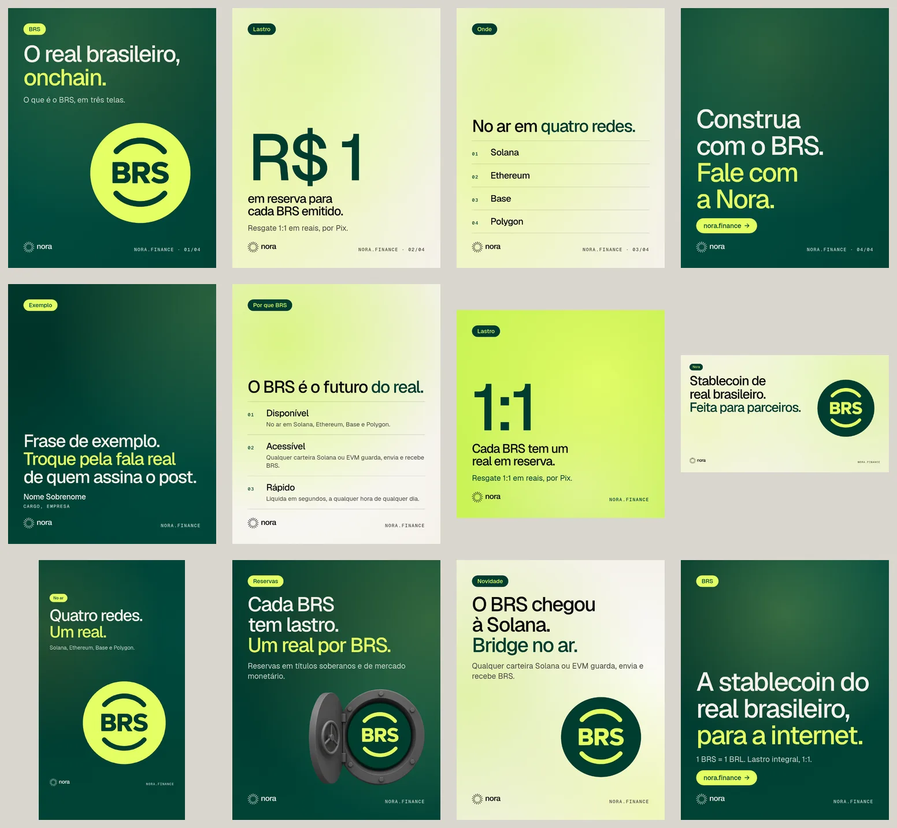

# Nora · marca e assets oficiais

<picture>
  <source media="(prefers-color-scheme: dark)" srcset="logo/svg/nora_logo-horizontal-short_fullcolor_on-dark_padded-outlined.svg">
  
</picture>

Identidade da [Nora Finance](https://www.nora.finance): guia de marca, logos,
cores, fontes e um gerador de posts para redes sociais que pessoas e IAs usam
do mesmo jeito.

| Preciso de… | Onde |
|---|---|
| Regras da marca: voz, cor, tipografia, logo, posts, imagem por IA | [GUIA-DE-MARCA.md](GUIA-DE-MARCA.md) |
| Ensinar uma IA a criar peças da Nora | [INSTALAR-NA-IA.md](INSTALAR-NA-IA.md) |
| Instruções que a IA segue ao trabalhar aqui | [AGENTS.md](AGENTS.md) |
| Criar um post | [social/](social/), seção Posts do guia |
| Logos | [logo/](logo/) |
| Cores | [colors/](colors/) |
| Fontes | [fonts/](fonts/) |

## Criar um post

```sh
python3 social/render.py social/exemplos/titulo-papel.json -o /tmp/nora
```

O post é descrito num JSON (formato, tema, layout e texto) e o gerador monta
a arte com fundo, tipografia e logo da marca. Ele recusa o que foge do guia:
cor ou layout fora da lista, emoji, texto que não cabe. Precisa de Python 3.10
ou mais novo e de Chromium ou Chrome, em Linux ou macOS.



## Logos

| Uso | Arquivo / pasta |
|---|---|
| Logo Nora | [logo/nora.svg](logo/nora.svg) |
| Logo Nora Finance | [logo/nora-finance.svg](logo/nora-finance.svg) |
| Símbolo | [logo/nora-symbol.svg](logo/nora-symbol.svg) |
| Símbolo PNG de 256 px | [logo/nora-256.png](logo/nora-256.png) |
| Todas as variantes SVG | [logo/svg/](logo/svg/) |
| PNG e WebP de 256 a 4096 px de largura | [logo/png/](logo/png/), [logo/webp/](logo/webp/) |
| Impressão | [logo/pdf/](logo/pdf/), [logo/eps/](logo/eps/) |
| Ícones de site e aplicativo | [logo/favicon/](logo/favicon/) |

URLs diretas:

```text
https://raw.githubusercontent.com/Nora-Finance/nora-assets/main/logo/nora.svg
https://raw.githubusercontent.com/Nora-Finance/nora-assets/main/logo/nora-finance.svg
https://raw.githubusercontent.com/Nora-Finance/nora-assets/main/logo/nora-symbol.svg
https://raw.githubusercontent.com/Nora-Finance/nora-assets/main/logo/nora-256.png
```

Como escolher a variante:

- `on-light`: uso sobre fundo claro. `on-dark`: uso sobre fundo escuro.
- `fullcolor`: cores da marca. `mono-black` e `mono-white`: monocromáticas.
- `horizontal-short`: wordmark Nora. `horizontal`: wordmark Nora Finance.
- `padded`: inclui área livre de 12,5%. `tight`: enquadramento justo.
- Os SVG de distribuição têm letras em contornos, sem depender de fonte instalada.

## Cores e fontes

Paleta em [tokens.json](colors/tokens.json), [CSS](colors/palette.css),
[SCSS](colors/palette.scss), [Tailwind](colors/tailwind.colors.js) e
[ASE](colors/nora.ase). O arquivo ASE e os swatches trazem só a paleta de
julho de 2026; as cores da linha atual do site (verde, lima do BRS e textos de
apoio) estão nos outros quatro.

Fontes Geist e Geist Mono 1.7.2 em [fonts/](fonts/), sob a
[SIL Open Font License](fonts/OFL.txt).

## Origem e integridade

Os logos são cópias exatas da biblioteca institucional **2.2.0**, com a
identidade aprovada **2.1**: símbolo simétrico de 17 raios com correção óptica
de +20% na largura. O [master](logo/master/nora-symbol.svg) tem SHA-256:

```text
b1a2c26f57b29166f32da7ed117608747523ba2fa556000fd93c375c2f4571c4
```

[manifest.json](manifest.json) registra a origem e o SHA-256 de cada asset
vindo da biblioteca. Confira os arquivos com `sha256sum -c SHA256SUMS`.

## Manutenção

Depois de mudar o gerador, rode a prova e refaça a galeria:

```sh
python3 social/test_render.py
python3 social/render.py social/exemplos/*.json -o /tmp/nora-exemplos
magick montage /tmp/nora-exemplos/*.png -tile 4x -geometry 360x450+14+14 -background '#D9D6CE' -quality 82 social/exemplos/galeria.webp
```

## Uso da marca

Marca e logo são propriedade da Nora Finance. Estes arquivos servem à
identificação da Nora em integrações e materiais institucionais. Não altere a
identidade nem sugira parceria ou endosso inexistente.

Os assets e contratos do token BRS estão em
[Nora-Finance/brs-assets](https://github.com/Nora-Finance/brs-assets).
